# ML data, features and EDA

16 Oct 2026 · Covers the ML trigger's training data as archived today (15 river stations, 36 rain stations within 25 km). The figures are in [figures/eda/](figures/eda/). Scripts: exploration code, not in the repo; every number below is reproducible from `floodready.ml.dataset` on the archive.

> **Note:** [evaluation-report.md](evaluation-report.md) was generated on 15 Oct from **10** river stations (684k rows). The archive now has **15** (1.05M rows), so the numbers here differ from that report.

## 1. What the model predicts

**Question:** "Will this river cross its own JPS warning level within the next 2 hours?" asked every 15 minutes at every river station that is still below warning.

- **Label** `cross_2h`: 1 if the level reaches `wl_warning_m` at any of the next 8 quarter hours. It comes from the river data itself, so no news labels are needed.
- **One pooled model** for all stations: every feature is relative to the station's own thresholds, so a 0.3 m rise means the same thing at a 2 m station and at a 20 m one.
- **Only data at or before t** goes into a row's features.

## 2. The 36 features and why each is there

### River state (7): the strongest signal

| Feature | What it is | Why |
| --- | --- | --- |
| `d_alert`, `d_warning`, `d_danger` | Level minus each JPS threshold (m) | How far the river is from trouble, in the station's own terms. The label is defined by `d_warning` crossing 0. |
| `level_rel` | (level − normal) / (danger − normal) | Scale-free position: 0 = normal, 1 = danger. Lets one model compare stations whose datums differ by 30 m. |
| `rise_15m`, `rise_60m`, `rise_120m` | Level change over 15 / 60 / 120 min | A rising river is the most direct evidence that water is arriving. Single-feature AUC 0.88–0.90, the best of all 36. |

### Rain (27): what drives inland flash floods

| Feature | What it is | Why |
| --- | --- | --- |
| `rain_{1h,2h,3h,6h,24h}_max_{10,25}km` | Highest rolling rain total at any gauge within 10 / 25 km | Flash floods in Klang come from small convective cells. The *max* catches a cell that hits one gauge. 1–3 h windows are intensity, 6–24 h are catchment wetness. |
| `rain_{…}_mean_{10,25}km` | Average over the same gauges | Separates a local cell from area-wide rain (monsoon surge). |
| `rain_2to4h_max_{10,25}km` | Largest 2-, 3- or 4-h total | Exactly the JPS rule's 2–4 h quantity, so ML sees what the rules see. |
| `rain_72h_ante_max_25km` | Rain in the 3 days *before* the last 24 h | Saturated ground and full drains turn the same storm into a flood. |
| `n_rf_10km`, `n_rf_25km` | Number of rain gauges in range | Intended to tell the model how much to trust the rain features. **Problem:** it is constant per station, so it works as a hidden station ID (§5.4). |

**10 km** is the local drainage area; **25 km** reaches the upstream catchment (a storm upstream arrives hours later).

### Tide (2): the lower Klang and coastal drains back up at high tide

| Feature | What it is | Why |
| --- | --- | --- |
| `tide_height_m` | Sea level near Port Klang (Open-Meteo Marine model) | At high tide water cannot drain to the sea. At the two tidal stations, 96.5% of crossings happen within 1.5 h of high tide (§5.3). |
| `hours_to_high_tide` | Signed hours to the nearest high tide (+ coming, − past) | Whether the water is about to get higher or lower. |

### Calendar (2)

| Feature | Why |
| --- | --- |
| `hour` | Convective storms peak in the afternoon and evening; tides shift ~50 min a day, so the morning and evening peaks in §5.3 come from both. |
| `month` | Inter-monsoon seasons (Apr–May, Oct–Nov) bring the heaviest afternoon storms. |

## 3. Shape of the data

| | |
| --- | --- |
| Raw archive | 15 river-level files (~87k quarter hours each, Apr 2024 → Oct 2026) and 70 rain files (~95k each, Jan 2024 → Oct 2026) from JPS Infobanjir; 24,528 hourly tide values |
| Full feature table | **1,466,040 rows × 42 columns** (one row per river station per quarter hour: 36 features + station, time, level, warning level, `cross_1h`, `cross_2h`) |
| Training rows | **1,052,331 × 36**: below warning and label known |
| Positives (`cross_2h` = 1) | **6,318 (0.60%)**, about 1 in 167 rows |
| Warning crossings (events) | **1,050** at 13 of 15 stations (2 never crossed) |
| Folds | 4 time-blocked folds (calendar quarters, round-robin): 203k / 310k / 309k / 231k rows, 1,239 / 1,577 / 1,603 / 1,899 positives |

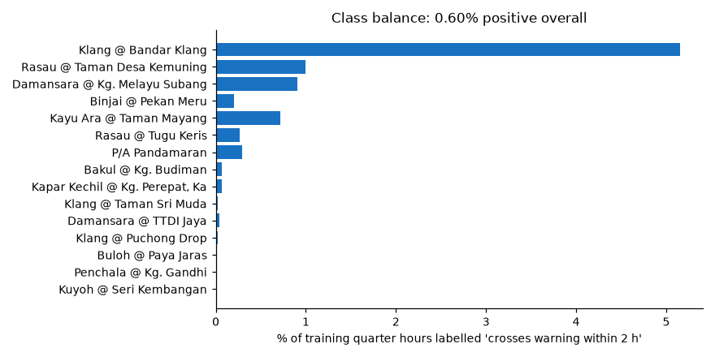

**Imbalance matters:** a model that always says "no flood" is 99.4% *accurate*. So we never report accuracy. We report detection (recall), false alarms and lead time per crossing event, and PR-AUC per row.

## 4. Feature engineering and selection done so far

**Engineering (yes, all of §2 is hand-built):**
1. **Normalisation by station thresholds** (`d_*`, `level_rel`): makes one pooled model possible, so 15 stations share 1,050 events instead of each learning from ~70.
2. **Differencing** (`rise_*`): turns a level into a rate.
3. **Rolling windows** (1 h → 72 h) on 15-min rain: turns noisy quarter hours into intensity and wetness.
4. **Spatial aggregation** (max / mean within 10 / 25 km): turns 36 gauges into station-relative rain without naming a gauge.
5. **Tide phase** from local maxima of the tide curve.
6. **Smoothing of the output** (max probability over the last 30 min), so one jumpy quarter hour doesn't flip an alert.

**Selection (no, not yet):** all 36 features go in. Gradient boosting tolerates redundant features, but §5.5 shows 12 near-duplicate pairs and §6 tests dropping them.

**Leakage controls (yes):** features use only data up to t; no station name; folds are whole calendar quarters so neighbouring quarter hours never sit on both sides; past events are replayed with the fold model that never saw them.

## 5. Exploratory data analysis

### 5.1 Coverage: most stations are 80–86% complete, four have a year-long hole

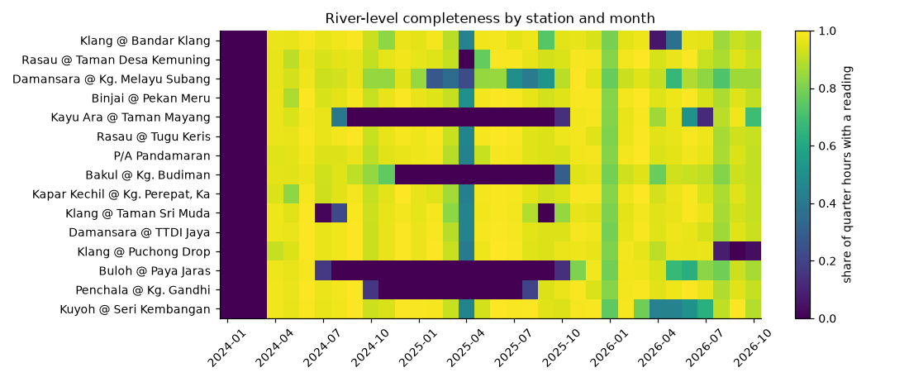

- River history starts Apr 2024 (JPS keeps no earlier 15-min water level); rain starts Jan 2024.
- **Kayu Ara, Bakul, Buloh and Penchala** have almost no readings from about Oct 2024 to Sep 2025. Their completeness is 39–57%.
- **Every station dips in Apr 2025**: a JPS-side gap, not a sensor fault.
- *So:* gradient boosting handles missing values natively, but these stations contribute fewer events, and their 2025 is absent from validation.

### 5.2 Rivers sit far below warning almost all the time

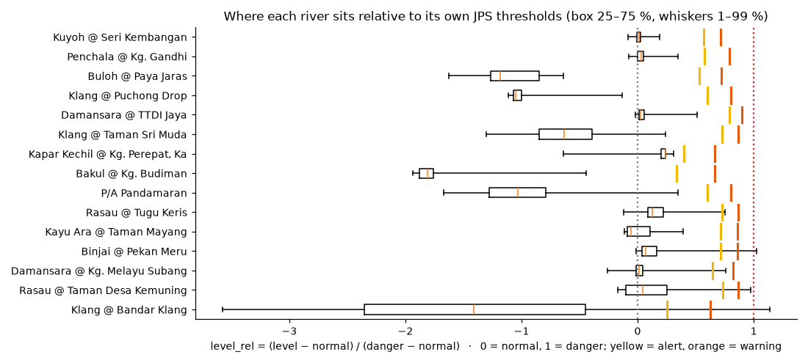

- Most stations spend 99% of the time between −0.5 and +0.5 on the `level_rel` scale, well below alert (yellow).
- **Bandar Klang** swings from −3.5 to +1.1 every day: that is the tide, not rain.
- **Puchong Drop, Penchala, Kuyoh** almost never get near warning, so they add negatives but no positives.
- *So:* the positives come from a handful of stations, and the model mostly learns "rising fast while already high".

### 5.3 Two kinds of crossing: spring tides and storms

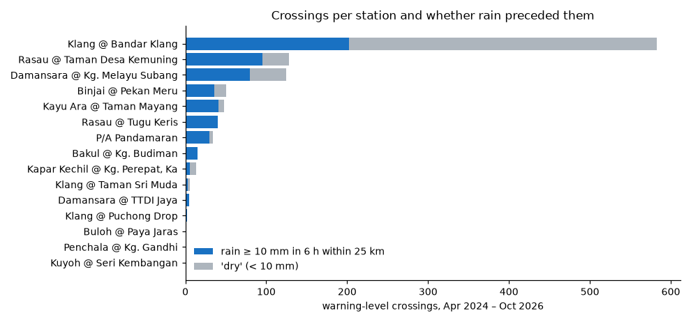
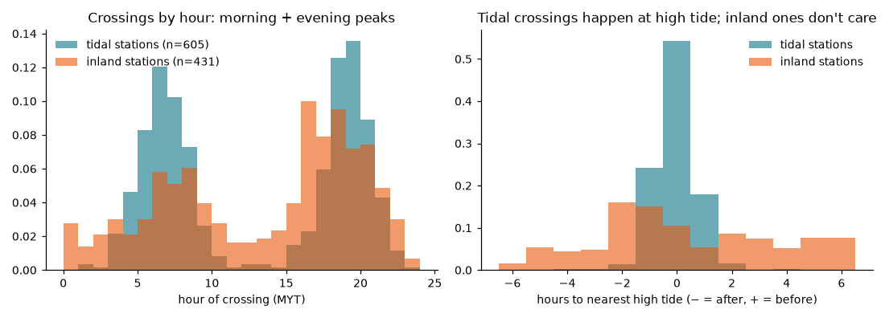

| | Tidal stations (Bandar Klang, Pandamaran) | Inland stations (other 11) |
| --- | --- | --- |
| Crossings | 617 (59%) | 433 (41%) |
| Within 1.5 h of high tide | **96.5%** (chance: 24%) | 31% (about chance) |
| No rain (< 10 mm in 6 h within 25 km) | **62%** | 25% |
| Median tide at crossing | 2.36 m (above the 90th percentile of all tides) | 1.19 m |

- **Bandar Klang alone holds 583 of 1,050 crossings (56%)** and spends 970 hours above warning. Its warning level (2.7 m) is reached by spring tides, so most of its "crossings" are tidal, not flash floods.
- Tidal stations cluster at high tide; inland stations cluster in the evening storm (16:00–21:00) and early morning.
- **A quarter of inland crossings had no rain at nearby gauges.** These are rain the gauges missed (cells between gauges, or upstream beyond 25 km) or backwater from the Klang.

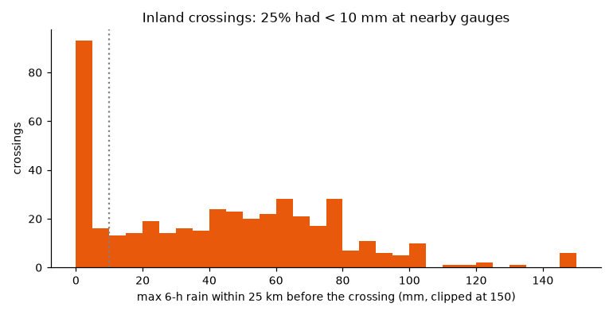

- *So:* one pooled model is being asked two different questions, and the tide one dominates the training signal. That is why the tide feature looks strong (AUC 0.82) and why pooled numbers flatter the model. Judge it on inland stations separately.

### 5.4 Which features carry signal on their own

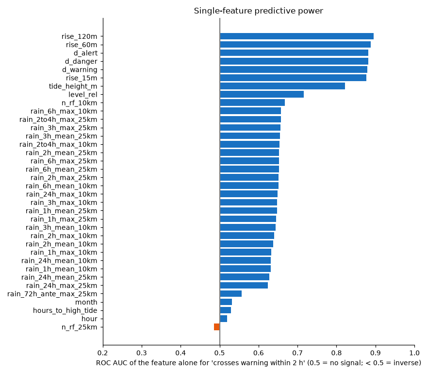

- **River state wins:** `rise_120m` 0.90, `rise_60m` 0.89, `d_*` 0.88, `rise_15m` 0.88.
- **Tide height 0.82**, driven by Bandar Klang (§5.3).
- **Rain features 0.62–0.66 each.** On their own they are weak, because most heavy rain doesn't cause a crossing and a quarter of crossings come without rain. They matter in combination with river state.
- **`n_rf_10km` scores 0.67** although a gauge count can't predict a flood. It is constant per station, so it identifies the station and lets the model learn each station's base rate. That contradicts the "no station identity" design and weakens transfer to new stations.
- **`hour`, `month`, `hours_to_high_tide`, `rain_72h_ante` are near 0.5 alone.** They only help through interactions (e.g. high tide *and* tidal station).

### 5.5 Redundancy

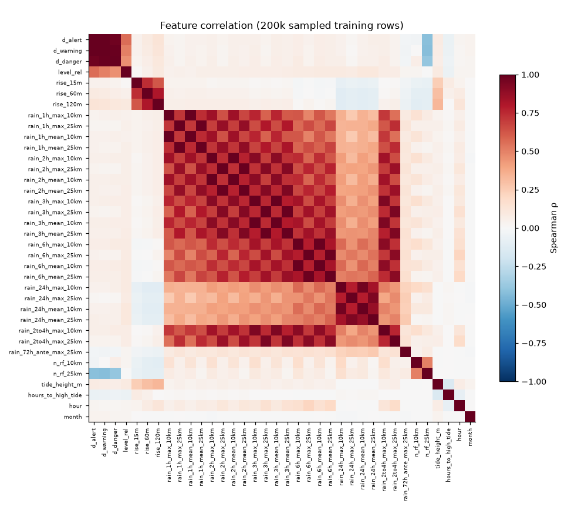

12 pairs have Spearman ρ ≥ 0.95:
- `d_alert` / `d_warning` / `d_danger` (0.97–0.99): they differ only by a constant per station.
- Each rain `max` with its `mean` at the same window and radius (0.97–1.00): with 15-min data, most quarter hours are 0 everywhere, and when it rains a single gauge usually dominates.

### 5.6 Data quality problems found

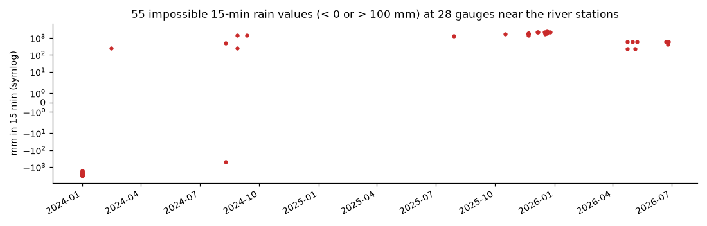

1. **Impossible rain values.** 55 rain readings near our river stations are below 0 or above 100 mm in 15 min (−3,275 to +2,050 mm), at 28 gauges. Across all 70 gauges, 100 readings exceed 200 mm/15 min or are negative. Causes:
   - JPS gauges report a cumulative counter, and after a gap or the 1 Jan reset the difference jumps.
   - Gauge 27879 repeats 296.5 mm for three days in Nov 2025.

   Nothing filters these. Because they enter rolling sums up to 72 h long, **65,662 training rows (6.2%)** have at least one rain feature changed by them, and the JPS rule fires on 1,221 extra quarter hours (21,430 → 20,209 after cleaning). This hits the rule baseline and the ML equally.
2. **Tide gaps.** Open-Meteo has no tide for 13–19 Jun 2024 and 29 Jan – 9 Feb 2025 (432 hours). `tide_height_m` is missing there, as it should be, but `hours_to_high_tide` is extrapolated across the gap, reaching **±137 h** (it should stay within ±6.5 h).
3. **Tide source vs news.** On 12 Nov 2024 the model tide is near *low* at 08:00–09:00, while news reports said high tide. Verify against JUPEM tables before quoting.

### 5.7 The 12 Nov 2024 event

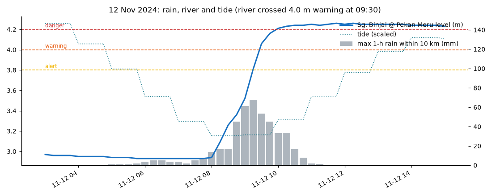

- Rain at the gauges within 10 km builds from 08:00 (14 mm in the last hour) and peaks at 67.5 mm/h at 09:15.
- The river is at 2.94 m at 08:00, crosses alert at 09:15 (3.81 m), warning at 09:30 (4.06 m) and danger at 10:00 (4.21 m), and stays above danger until at least 15:00.
- The tide model puts 08:00 at low water (6 h to high tide), so by this data the storm alone did it.
- The river rose 1.12 m in 90 minutes. **Lead time is fundamentally bounded by how early rain is seen:** rain-based signals can't fire before 08:00, so 90 min is about the ceiling unless we see the storm before it rains here (radar or nowcast, §7).

## 6. Experiments

All runs use the same 4 time-blocked folds and out-of-fold probabilities, and the same event scoring as [evaluation-report.md](evaluation-report.md): a crossing counts as detected if the signal fired 15 min to 3 h before it, and a false alarm is an alarm with no crossing in the next 3 h. *Alarm precision* is the share of alarms followed by a crossing. Each ML row uses the threshold picked by `evaluate.pick_threshold`.

| Variant | Features | ROC-AUC | PR-AUC | Detected / 1,050 | Median lead | False alarms / station-month | Alarm precision |
| --- | --- | --- | --- | --- | --- | --- | --- |
| JPS rule floor (rain Watch or river at alert) | – | – | – | **1,004 (95.6%)** | 52 min | 6.43 | 21% |
| A: current pipeline (p ≥ 0.5) | 36 | 0.981 | 0.699 | 954 (90.9%) | 150 min | 6.47 | 22% |
| B: A + rain QC + tide fix (p ≥ 0.6) | 36 | 0.981 | 0.706 | 952 (90.7%) | **150 min** | **5.60** | **25%** |
| C: B minus 12 redundant features (p ≥ 0.6) | 24 | 0.981 | 0.704 | 955 (91.0%) | 150 min | 5.98 | 24% |
| D: B + 5 engineered features (p ≥ 0.5) | 41 | 0.984 | 0.715 | 955 (91.0%) | 150 min | 6.22 | 23% |

D adds rise over 30 min, acceleration, 24-h max of `level_rel`, the 1-h tide change, and 1-h rain × `level_rel`.

**Inland stations only** (Bandar Klang removed, 467 crossings):

| | Detected | Median lead | False alarms / station-month |
| --- | --- | --- | --- |
| Rule floor | 423 (90.6%) | 90 min | 5.48 |
| ML, variant B | 372 (79.7%) | 120 min | 4.79 |

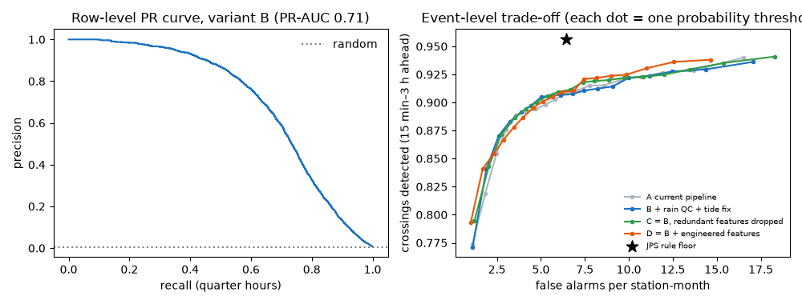

**Threshold trade-off (variant B):**

| p ≥ | Detected | Median lead | False alarms / station-month | Alarm precision |
| --- | --- | --- | --- | --- |
| 0.25 | 92.4% | 165 min | 11.2 | 14% |
| 0.60 | 90.7% | 150 min | 5.6 | 25% |
| 0.80 | 88.3% | 135 min | 3.2 | 37% |
| 0.90 | 84.1% | 135 min | 1.9 | 49% |
| 0.95 | 77.1% | 120 min | 1.1 | 60% |

**Calibration (variant B):** the probabilities are far too high, because `class_weight="balanced"` up-weights the 0.6% positives about 80×.

| Predicted p | 0.05–0.1 | 0.1–0.2 | 0.2–0.3 | 0.3–0.5 | 0.5–0.7 | 0.7–0.9 | 0.9–1.0 |
| --- | --- | --- | --- | --- | --- | --- | --- |
| Actually crossed | 0.5% | 1.0% | 1.3% | 2.6% | 4.6% | 8.3% | 57% |

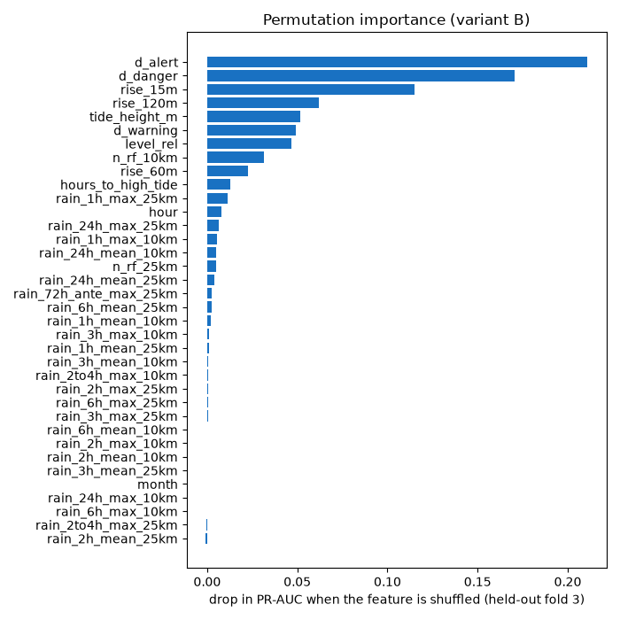

**Permutation importance** (held-out fold 3, drop in PR-AUC when a feature is shuffled):
- River state dominates: `d_alert` 0.21, `d_danger` 0.17, `rise_15m` 0.11, `rise_120m` 0.06.
- Then `tide_height_m` 0.05 and `n_rf_10km` 0.03 (the station proxy).
- The best rain feature is `rain_1h_max_25km` at 0.011; most rain features and `month` score about 0. Once the river is rising, the rain that caused it adds little.

### What the experiments say

1. **The two methods have opposite strengths.**
   - The rule floor detects the most crossings, but many of them only 15–60 min ahead, because "river at alert" fires when the river is already nearly there.
   - ML detects ~5 points fewer but **~100 min earlier**, with **13% fewer false alarms** (5.60 vs 6.43) and a higher alarm precision.
   - The gate fails on its first condition (ML must detect at least as many crossings as the floor), not on lead or false alarms.
2. **Rain QC and the tide fix help a little** (false alarms 6.47 → 5.60 at matched detection). They are correctness fixes and should go in regardless.
3. **Feature selection and extra engineering are flat (±0.01 PR-AUC).** A third of the features can go at no cost. Gains will not come from reshuffling these features.
4. **Inland flash floods are the harder, more important problem:** ML catches 80% of inland crossings vs the floor's 91%. The pooled 91% is lifted by easy, tide-locked crossings at Bandar Klang.
5. **Displayed probabilities must not be shown raw.** "54%" on 12 Nov 2024 corresponds to roughly a 5% observed rate at that score.

## 7. Conclusions and recommendations

**About the data.**
- It is rich: 1.05M labelled quarter hours and 1,050 crossings, with free labels.
- Its signal is river state first, tide second, rain third.
- It holds two populations, tidal stations (59% of crossings, mostly spring tides) and inland flash floods (41%).
- It has three fixable defects: impossible rain values, extrapolated tide timing, and a station-ID proxy.

**Accuracy is the wrong metric.** With 0.6% positives, always saying "no" is 99.4% accurate. Both methods detect 90–96% of crossings. Their weakness is precision: only 1 alarm in 4–5 is followed by a crossing within 3 h.

### Recommended changes, in order of value for the hackathon

| # | Change | Why | Effort |
| --- | --- | --- | --- |
| 1 | **Rain QC** in `infobanjir`/`dataset`: drop readings < 0 or > 100 mm/15 min, flag them | Correctness; lowers false alarms for rules and ML | S |
| 2 | **Tide fix**: blank `hours_to_high_tide` where the tide is missing; better, fill gaps with a harmonic tide fit (M2, S2, K1, O1) | Removes ±137 h nonsense | S |
| 3 | **Calibrate** (isotonic regression on out-of-fold probabilities, per fold) before showing a probability anywhere | Today's 54% means ~5% | S |
| 4 | **Drop `n_rf_10km` / `n_rf_25km`** and the 12 redundant features | Station-ID leak; no loss in accuracy | S |
| 5 | **Split tidal from inland**: add a data-driven `tidal_range_7d` feature, or train inland-only, and report inland metrics as the headline | The product is about flash floods; tides inflate the pooled numbers | M |
| 6 | **Upstream river features**: rise at the river stations upstream on the same river (JPS station network) | River state is the strongest signal; upstream rise arrives earlier | M |
| 7 | **Two-tier alerts**: ML at a high threshold (p ≥ 0.9: 84% detected, 135 min lead, 1.9 false alarms/month) as the early *Watch*; the rule floor confirms *Warning* | Uses each method's strength; easy to explain | S |
| 8 | **Archive all ~100 Selangor/KL river stations** and retrain | More inland events, which are the scarce class | M (time) |
| 9 | Rain nowcast or radar (MET Malaysia) for lead beyond ~90 min | Rain-based signals can't fire before it rains here | L |

On #7: the current gate requires ML to detect at least as many crossings as the floor, which a 2-hour-ahead model can't do against a signal that fires 15 min before. Changing the gate now would be moving the goalposts after seeing results. If the team wants it, write the new criterion first (e.g. "at matched false alarms, ≥ 60 min more lead and ≥ 85% detection"), then re-run on fresh folds.

### Model choice

- **Keep gradient boosting.** `HistGradientBoostingClassifier` is the same algorithm as LightGBM. XGBoost, LightGBM or CatBoost would land within about ±0.01 PR-AUC, as variants A–D did. It handles missing readings natively, trains in seconds and is easy to explain.
- **Worth adding:**
  - **Isotonic calibration** (#3).
  - **Light hyper-parameter search** over time-blocked folds (depth, leaves, learning rate, `class_weight` none vs balanced).
  - **A quantile level forecast** (`HistGradientBoostingRegressor(loss="quantile")`, level at +1 h / +2 h, 10/50/90%). It turns a probability into "Sg. Binjai likely reaches 4.1 m (3.9–4.3) by 10:30", which residents and judges understand and which can be checked against the gauge.
  - **Logistic regression** on a handful of features, as an explainable baseline.
- **Not now:** LSTMs, TCNs or transformers on raw sequences. With 467 inland events they would overfit, need far more tuning, and are hard to explain in 5 minutes.
